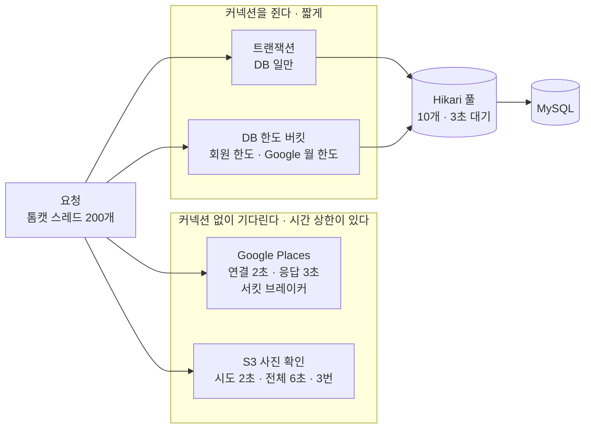
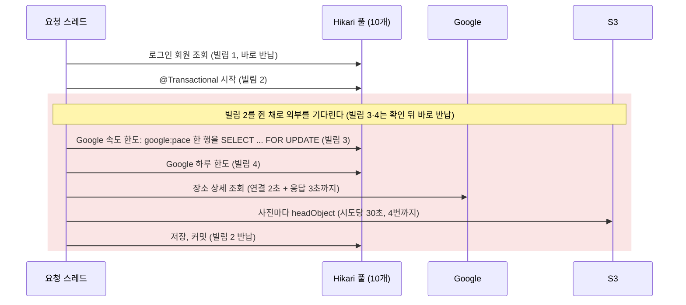
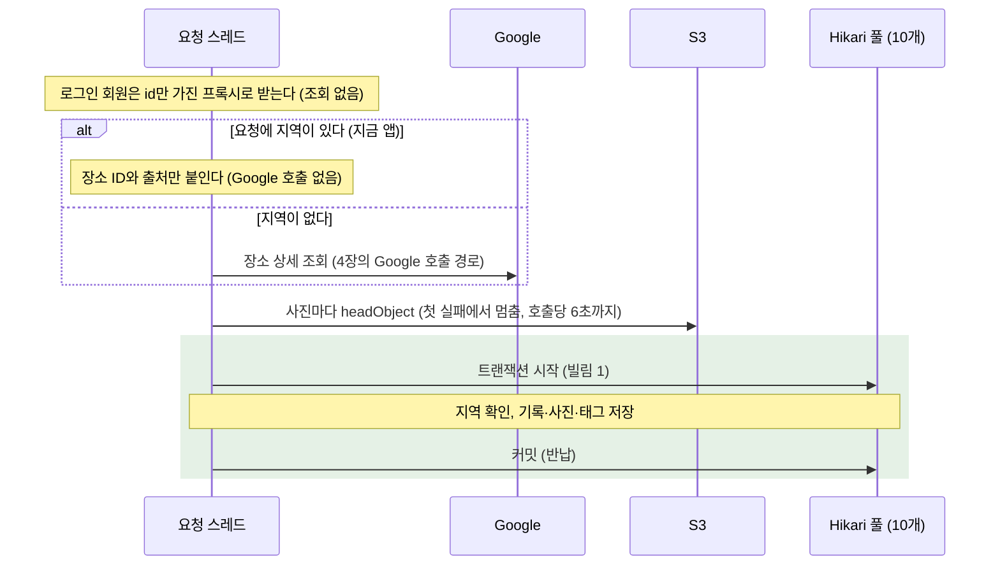
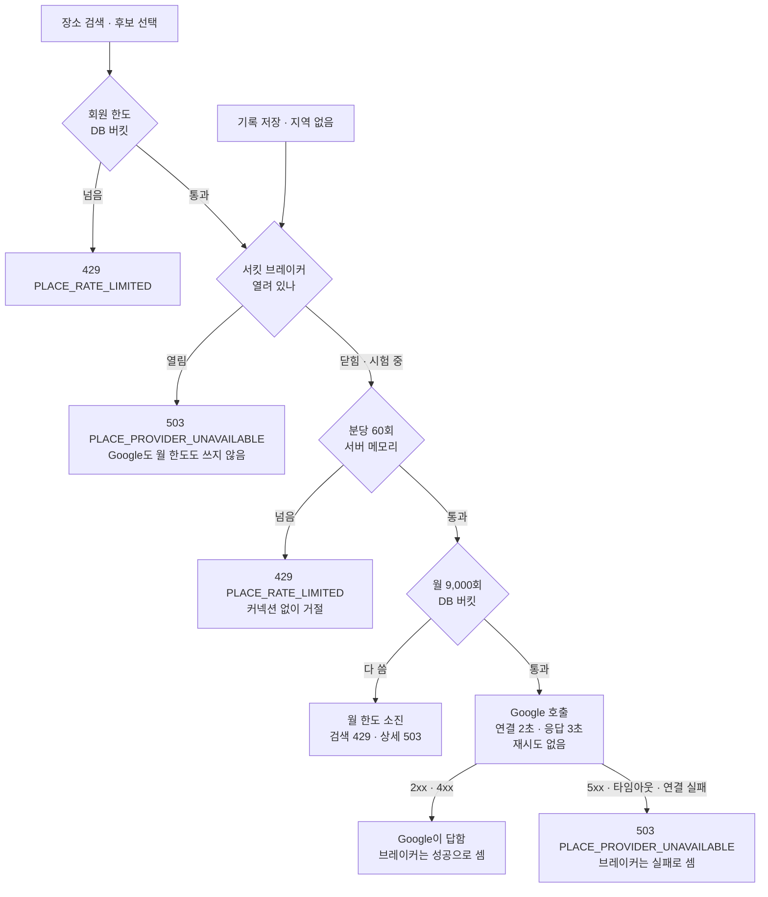
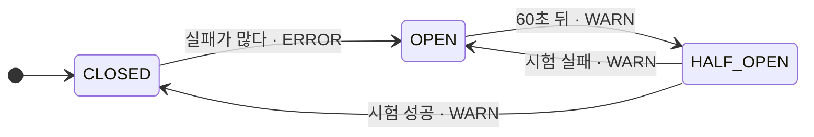
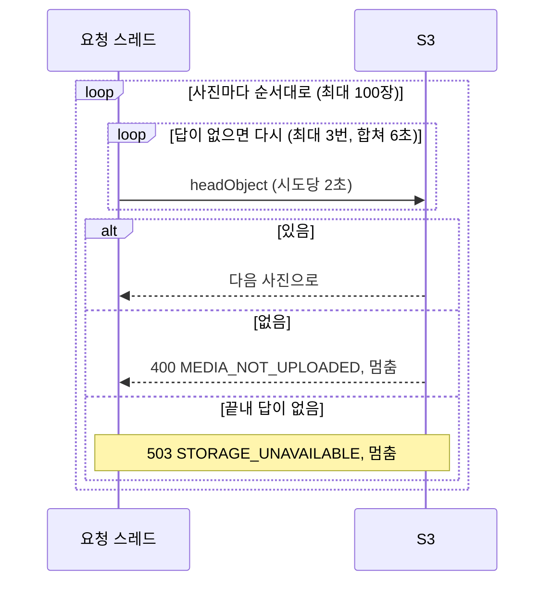

# 커넥션 풀과 외부 호출 보호 구조

> 기준: `backend-develop` 89b8b164 (2026-10-14). 커넥션 풀 고갈 개선 1~5(#342, #350, #352, #354, #355)와
> 외부 API 장애 대응(#346: #363, #365)을 반영한다.

부하 테스트에서 DB 커넥션 풀이 먼저 바닥났고, Google이 멈추면 기록과 무관한 API까지 실패했다.
이 문서는 그 뒤 바꾼 요청 흐름을 그림으로 정리한다. 한도 값과 오류 코드의 자세한 설명은
[장소 검색과 여행 기록 연결](place-search.md#호출-한도)과
[ADR 0018](adr/0018-verify-uploaded-object-before-linking.md)에 있다.

## 1. 지키는 자원

요청 하나가 쓰는 자원은 셋이다. 하나가 바닥나면 그 자원을 쓰는 모든 API가 함께 멈춘다.

| 자원 | 크기 | 누가 쥐나 | 바닥나면 |
| --- | --- | --- | --- |
| 톰캣 요청 스레드 | 200개(Spring Boot 기본값) | 요청 하나가 끝날 때까지 | 모든 API가 대기 |
| DB 커넥션(Hikari) | 10개, 빌릴 때 3초까지 대기 | 트랜잭션, DB 한도 버킷(Bucket4j MySQL) 확인 | DB를 쓰는 API가 3초 뒤 실패 |
| Google 월 한도 | 자동완성·상세 각 9,000회 | Google 호출 하나 | 그달 장소 검색·선택이 막힘 |

원칙은 두 가지다. 커넥션은 DB 일을 하는 동안만 짧게 쥐고, 외부(Google, S3)는 커넥션 없이 정해진 시간까지만 기다린다.

## 2. 개선 전: 무엇이 풀을 고갈시켰나

개선 전(`19d42eba`) Google 장소를 붙인 기록 저장은 커넥션을 4번 빌렸고, 그중 하나를 Google과 S3를 기다리는 내내 쥐고 있었다.

부하 테스트에서 이렇게 드러났다.

- **Google이 멈추면**(`s2 CASE=hang`): 풀이 2초 안에 고갈됐다. 기록과 무관한 `GET /travel-records`도 p95가 57ms에서 5.3초로 늘고 약 54%가 500으로 실패했다(로컬. dev에서는 약 60%가 실패).
- **Google이 정상이어도**(dev `s3 stress`): 390 req/s에서 풀이 먼저 꺾였다. 요청당 커넥션을 평균 2.2번 빌렸고 한 번에 13.2ms 쥐었다. 리틀의 법칙으로 390 × 2.2 × 0.0132 ≈ 11.3개가 필요해 10개를 넘는다.
- **한도 확인이 줄을 세웠다**: 모든 Google 호출이 `google:pace` 행 하나를 잠그려고 커넥션을 쥔 채 기다렸다. 풀이 고갈되면 한도에 걸려 거절될 요청도 커넥션을 기다리다 실패했다.

## 3. 개선 후: 기록 저장

외부 호출을 먼저 끝내고, DB 일만 트랜잭션 하나로 묶는다(`TravelRecordService.create`, `TransactionTemplate`).

요청별로 커넥션을 몇 번 빌리는지와, 외부를 기다리는 동안 쥐는 커넥션 수는 이렇게 바뀌었다.

| 요청 | 빌리는 횟수(전 → 후) | 외부를 기다리며 쥐는 커넥션(전 → 후) |
| --- | --- | --- |
| 로그인 회원 API(예: `GET /travel-records`) | 2 → 1 | 0 → 0 |
| 기록 저장: 장소 + 지역(지금 앱) | 4 → 1 | 1 → 0 |
| 기록 저장: 장소만, 지역 없음 | 4 → 2(트랜잭션, Google 월 한도) | 1 → 0 |
| 기록 저장: 장소 없음 | 2 → 1 | 사진이 있으면 1 → 0 |
| 장소 검색 | 3 → 2(회원 한도, Google 월 한도) | 0 → 0 |

## 4. Google 호출 경로

장소 검색·선택과 지역 없는 기록 저장이 이 경로로 Google을 부른다. 회원 한도는 인터셉터(`PlaceRateLimitInterceptor`)가, 나머지는 `GooglePlacesClient`가 확인한다. 서킷 브레이커가 한도 확인보다 앞에 있어, 회로가 열린 동안 거절한 요청은 Google도 월 한도도 쓰지 않는다.
분당 한도는 메모리에서 먼저 보므로, 몰린 요청은 커넥션 없이 거절된다.

Google 결과마다 브레이커가 어떻게 세고 월 한도를 돌려주는지는 이렇다(`GoogleCircuitBreakerConfig`, `GooglePlacesClient`).

| 결과 | 브레이커 | 월 한도 | 이유 |
| --- | --- | --- | --- |
| 2xx | 성공 | 씀 | |
| 4xx | 성공 | 씀 | Google이 답했다. 상세 조회의 404와 키 오류가 아닌 400은 `PLACE_NOT_FOUND`다 |
| 5xx | 실패 | 돌려줌 | Google은 서버 오류를 과금하지 않는다 |
| 연결 거부 · 연결 타임아웃 · 없는 호스트 | 실패 | 돌려줌 | 요청이 Google에 닿지 않았다 |
| 응답 타임아웃 | 실패 | 씀 | 연결 뒤 끊겨 Google이 처리하고 과금했을 수 있다 |
| 우리 분당 · 월 한도 거절 | 세지 않음 | 분당 거절은 쓰지 않음 | Google을 부르지 않았다 |

## 5. Google 서킷 브레이커 상태

서버마다 최근 60초를 센다(`google.places.circuit-breaker`). 운영 ERROR 로그 알람(Discord)이 장애 하나에 한 번만 울리도록, 닫혀 있다 열릴 때만 ERROR 로그(`event=GOOGLE_PLACES_CIRCUIT`)를 남긴다.

| 전이 | 조건 | 로그 |
| --- | --- | --- |
| CLOSED → OPEN | 최근 60초에 5번 이상 불렀고 절반 이상 실패 | ERROR(Discord 알림) |
| OPEN → HALF_OPEN | 60초가 지난 뒤 첫 호출. 그 전까지는 한도 확인 전에 바로 503 | WARN |
| HALF_OPEN → CLOSED | 시험 3번 중 실패 1번 이하 | WARN |
| HALF_OPEN → OPEN | 시험 3번 중 실패 2번 이상 | WARN |

Google이 2시간 동안 답하지 않으면(응답 타임아웃은 월 한도를 돌려주지 않는다), 브레이커가 없을 때는 요청이 몰리면 분당 60회씩 7,200회(월 한도의 80%)를 쓴다. 지금은 60초마다 시험 3번이라 최대 360회(4%)다.

## 6. S3 사진 확인

기록 저장은 사진마다 S3 `headObject`로 업로드됐는지 확인한다(`UploadedObjectVerifier`). 한 장이라도 실패하면 나머지는 확인하지 않는다.

| | SDK 기본값(개선 전) | 지금(`upload.storage.s3.client`) |
| --- | --- | --- |
| 시도당 응답 대기 | 30초 | 2초 |
| 최대 시도 | 4번 | 3번 |
| 호출 하나 전체 | 제한 없음(2분 가까이) | 6초 |

S3가 멈추면 기록 저장은 사진 수와 관계없이 6초 안에 503으로 끝난다. 느리지만 답은 하는 S3에서는 사진마다 6초까지 쌓일 수 있다.

**S3 서킷 브레이커와 벌크헤드는 지금은 달지 않는다**(2026-10-14 결정).

- 톰캣 스레드 200개를 6초씩 쥐어 다 쓰려면 기록 저장이 초당 약 33건(200 ÷ 6) 와야 한다.
- SDK 재시도에도 토큰 통이 있다(500개, 재시도마다 5개, 성공하면 다시 참). 장애가 길어지면 재시도를 멈추고 2초 한 번만 시도해, 그 뒤로는 초당 약 100건이 와야 다 쓴다. 첫 시도는 막지 않는다.
- 사진은 앱이 presigned URL로 S3에 직접 올린다. S3가 멈추면 대부분 업로드에서 먼저 실패해 기록 저장까지 오지 않는다.
- 브레이커가 잘못 열리면 핵심 기능인 기록 저장이 막힌다.
- 기록 저장이 초당 수십 건이 되면 다시 본다. 그때 스레드 고갈만 막으려면 S3를 기다리는 스레드 수를 제한하는 벌크헤드가 맞다.

## 7. 개선별 요약

| 개선 | PR | 바꾼 것 | 막은 문제 |
| --- | --- | --- | --- |
| 1 | #342 | 로그인 회원을 조회하지 않고 id 프록시로 주입(`EntityManager.getReference`) | 요청마다 트랜잭션 밖에서 커넥션을 한 번 더 빌림 |
| 2 | #350 | Google·S3 호출을 트랜잭션 밖으로, DB 일만 `TransactionTemplate` | 외부를 기다리는 동안 커넥션을 쥠 |
| 3 | #352 | 지역이 있는 기록 저장·수정은 Google을 다시 부르지 않음 | 장소 기록마다 Google 상세 조회를 두 번 함 |
| 4 | #354 | Google 분당 한도를 서버 메모리로, 하루 300회를 월 9,000회로 | 모든 Google 호출이 DB 행 하나를 잠그며 줄 섬 |
| 5 | #355 | Geoapify 제거, 회원 한도를 인터셉터(`place/ratelimit`)로 | 회원 한도와 제공자 한도가 한 클래스에 섞임 |
| #346 | #363 | S3 시도 2초 · 전체 6초 · 3번 | S3가 멈추면 호출 하나가 스레드를 2분 가까이 쥠 |
| #346 | #365 | Google 서킷 브레이커, 과금되지 않은 실패의 월 한도 환불 | Google 장애 동안 사용자가 3초씩 기다리고 월 한도를 씀 |

## 8. 남은 한계

- **풀 크기는 10개 그대로다.** 개선 후 dev에서 같은 조건으로 다시 재고, DB CPU와 함께 보고 정한다.
- 서킷 브레이커는 서버마다 메모리에서 센다. 서버가 여러 대면 서버마다 따로 열린다.
- 앱은 Google 장소를 골라야 새 기록을 만들 수 있어, Google 장애가 기록 생성을 막는다. 서버는 지역만으로도 Google 없이 기록을 만든다. 장소 검색이 실패할 때 지역 직접 선택으로 넘어가는 것은 앱에서 다룬다.
- 로그인 회원 프록시는 회원이 있는지 확인하지 않는다. 회원 행이 없는 토큰은 조회에서 빈 결과를, 저장에서 외래 키 위반(500)을 낸다([ADR 0009](adr/0009-authentication-with-spring-security-and-jwt.md)).

## 9. 지키는 테스트

백엔드 PR마다 CI(`Backend CI`)에서 돈다.

| 지키는 것 | 테스트 |
| --- | --- |
| 로그인 회원 API가 커넥션을 한 번만 빌림 | [`LoginMemberConnectionUsageTest`](../src/test/java/com/mapmory/backend/auth/security/resolver/LoginMemberConnectionUsageTest.java) |
| 기록 저장·수정의 외부 호출이 트랜잭션 밖 | [`TravelRecordExternalCallTransactionTest`](../src/test/java/com/mapmory/backend/travelrecord/TravelRecordExternalCallTransactionTest.java) |
| 지역이 있는 기록 저장·수정은 Google을 부르지 않음 | [`TravelRecordGooglePlaceTest`](../src/test/java/com/mapmory/backend/travelrecord/TravelRecordGooglePlaceTest.java) |
| 분당 한도 거절은 풀이 고갈돼도 커넥션 없이, 월 한도 환불 | [`GoogleRequestLimiterIntegrationTest`](../src/test/java/com/mapmory/backend/place/infrastructure/google/GoogleRequestLimiterIntegrationTest.java) |
| 서킷 브레이커 상태와 로그 수준, 환불 기준 | [`GooglePlacesClientTest`](../src/test/java/com/mapmory/backend/place/infrastructure/google/GooglePlacesClientTest.java) |
| S3가 답하지 않으면 6초 안에 3번 시도하고 503 | [`S3ClientTimeoutTest`](../src/test/java/com/mapmory/backend/upload/storage/S3ClientTimeoutTest.java) |
