# 커넥션 풀 고갈 개선: 개선 전과 지금 구조

> 기준: 개선 전 `19d42eba`, 지금 `backend-develop` 89b8b164 (2026-10-14).
> 커넥션 풀 고갈 개선 1~5(#342, #350, #352, #354, #355)와 외부 API 장애 대응(#346: #363, #365)을 다룬다.

부하 테스트에서 DB 커넥션 풀이 가장 먼저 바닥났다. Google이 멈추자 Google과 상관없는 기록 목록 API까지 절반 넘게 실패했다.
이 문서는 무엇이 문제였고 구조를 어떻게 바꿨는지를 개선 전과 지금으로 나란히 보여 준다.
한도 값과 오류 코드는 [장소 검색과 여행 기록 연결](place-search.md#호출-한도)에, S3 사진 확인은 [ADR 0018](adr/0018-verify-uploaded-object-before-linking.md)에 자세히 있다.

## 0. 먼저 알아 둘 말

| 말 | 뜻 |
| --- | --- |
| 요청 스레드 | 톰캣이 요청 하나를 처리하는 동안 쓰는 스레드다. 200개(Spring Boot 기본값)다. |
| 커넥션 풀 | 미리 열어 둔 DB 연결 묶음(HikariCP)이다. 우리는 10개다. DB를 쓰려면 하나를 빌리고, 다 쓰면 돌려준다. 남은 게 없으면 3초까지 기다리다 실패한다. |
| 트랜잭션 | 여러 DB 작업을 하나로 묶는 단위다. 시작할 때 커넥션을 빌리고 끝날 때 돌려준다. 그래서 트랜잭션 안에서 무언가를 기다리면 그동안 커넥션을 쥐고 있다. |
| 외부 호출 | 우리 서버 밖 서비스를 부르는 일이다. 장소 검색은 Google Places, 사진 확인은 AWS S3를 부른다. 얼마나 걸릴지 우리가 정할 수 없다. |
| 한도 버킷 | 몇 번까지 부를 수 있는지 세는 카운터(Bucket4j)다. 서버 여러 대가 함께 세야 하는 한도는 DB 테이블(`place_rate_limit_bucket`)에 두고, 확인할 때마다 커넥션을 빌려 그 행을 잠근다(`SELECT ... FOR UPDATE`). |
| 서킷 브레이커 | 외부가 계속 실패하면 잠시 부르지 않고 바로 실패시키는 장치다. 전기 차단기처럼 회로가 "열리면" 막는다. |

## 1. 한눈에 보기

| | 개선 전 | 지금 |
| --- | --- | --- |
| 로그인한 요청이 커넥션을 빌리는 횟수 | 2번 | 1번 |
| 장소를 붙인 기록 저장 | 커넥션을 4번 빌리고, 그중 하나를 Google·S3를 기다리는 내내 쥔다 | 1번 빌리고, 외부를 기다릴 때는 쥐지 않는다 |
| Google 호출 한도 확인 | 모든 호출이 DB 행 하나를 잠그려고 줄 선다 | 분당 한도는 메모리에서, 월 한도만 DB에서 센다 |
| Google이 멈추면 | 풀이 2초 안에 바닥나 무관한 API도 실패한다 | 장소 검색·선택만 실패한다. 회로가 열리면 기다리지 않고 바로 503 |
| S3가 멈추면 | 사진 확인 하나가 요청 스레드를 2분 가까이 쥔다 | 6초 안에 503으로 끝난다 |

"지금" 열은 코드에서 확인한 것이다. 같은 조건의 dev 재측정은 아직 하지 않았다.

## 2. 전체 구조

점선은 커넥션을 빌리는 곳이다. 빨간 칸은 문제가 있던 곳, 초록 칸은 바꾼 곳이다.

### 개선 전

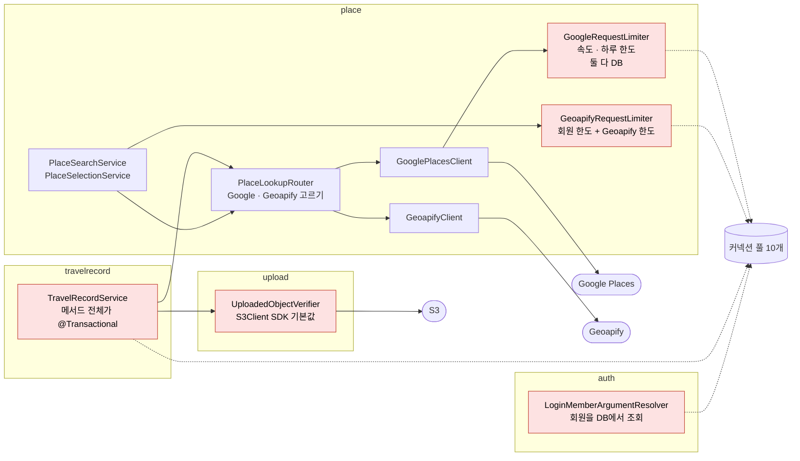

### 지금

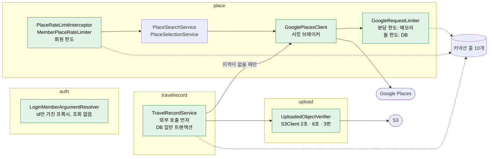

바뀐 점을 도메인별로 보면 이렇다.

| 도메인 | 개선 전 | 지금 | PR |
| --- | --- | --- | --- |
| auth | 로그인 회원을 DB에서 조회해 주입 | id만 가진 프록시를 주입 | #342 |
| travelrecord | 기록 저장 전체가 트랜잭션, 그 안에서 Google·S3 호출 | 외부 호출을 먼저 하고 DB 일만 트랜잭션 | #350 |
| travelrecord | 장소를 붙인 저장마다 Google 상세 조회 | 지역이 있으면 Google을 부르지 않음 | #352 |
| place | Google 속도 한도가 DB 행 하나 | 분당 한도는 서버 메모리, 월 한도만 DB | #354 |
| place | Geoapify 한도 클래스가 회원 한도까지 맡음 | Geoapify 제거, 회원 한도는 인터셉터 | #355 |
| place | Google이 멈춰도 계속 부르고 한도를 씀 | 서킷 브레이커, 과금되지 않은 실패는 월 한도 환불 | #365 |
| upload | S3를 시도당 30초씩 4번까지 기다림 | 시도당 2초, 합쳐 6초, 3번 | #363 |

## 3. 로그인 회원 주입 (개선 1, #342)

`open-in-view`가 꺼져 있어, 컨트롤러에 회원을 넣는 resolver가 DB를 조회하면 서비스 트랜잭션과 따로 커넥션을 한 번 더 빌린다.

### 개선 전

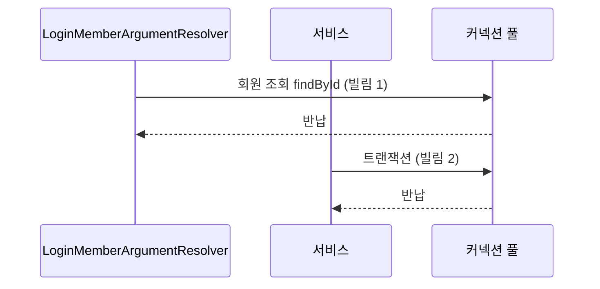

### 지금

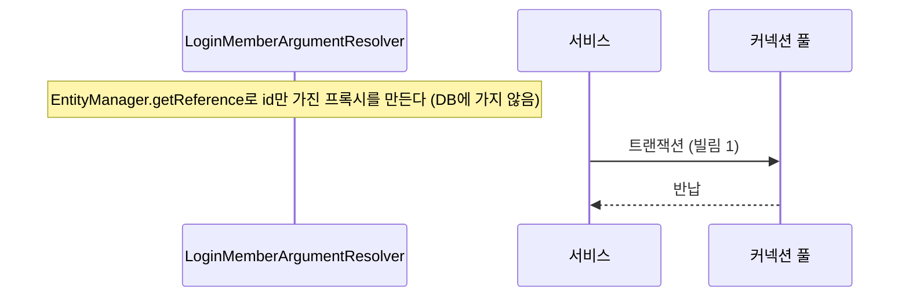

회원 행이 없는 토큰도 프록시가 만들어진다. 조회는 빈 결과, 저장은 외래 키 위반(500)이 된다. 회원 삭제 기능을 만들 때 함께 다룬다([ADR 0009](adr/0009-authentication-with-spring-security-and-jwt.md)).

## 4. 기록 저장 (개선 2·3, #350·#352)

### 개선 전

Google 장소를 붙인 기록 저장은 커넥션을 4번 빌렸고, 그중 하나(트랜잭션)를 Google과 S3를 기다리는 내내 쥐고 있었다.

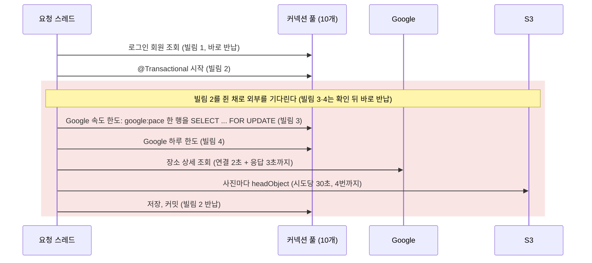

Google이 멈추면 기록 저장 요청들이 커넥션을 하나씩 쥔 채 Google을 기다린다. 10개가 다 잡히면 Google과 상관없는 요청도 빌릴 커넥션이 없다.

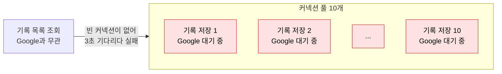

부하 테스트에서 실제로 이렇게 됐다.

- **Google이 멈추면**(`s2 CASE=hang`): 풀이 2초 안에 바닥났다. 기록 목록 `GET /travel-records`도 p95가 57ms에서 5.3초로 늘고 약 54%가 500으로 실패했다(로컬. dev에서는 약 60%가 실패).
- **Google이 정상이어도**(dev `s3 stress`): 390 req/s에서 풀이 먼저 꺾였다. 요청당 커넥션을 평균 2.2번 빌렸고 한 번에 13.2ms 쥐었다. 리틀의 법칙으로 390 × 2.2 × 0.0132 ≈ 11.3개가 필요해 10개를 넘는다.

### 지금

외부 호출을 먼저 끝내고, DB 일만 트랜잭션 하나로 묶는다(`TravelRecordService.create`, `TransactionTemplate`).
지금 앱은 장소와 함께 지역을 항상 보내므로, 기록 저장은 Google을 부르지 않는다.

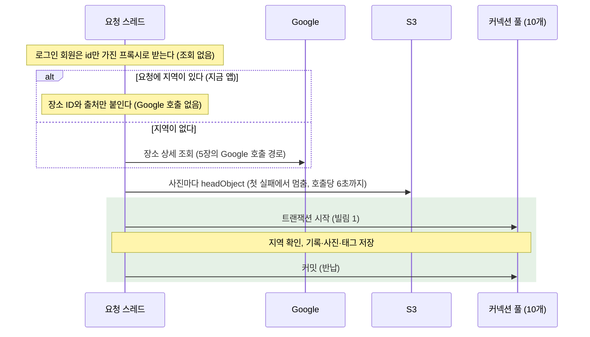

## 5. 장소 검색 한도 (개선 4·5, #354·#355)

### 개선 전

회원 한도는 Geoapify 한도 클래스가 함께 셌고, Google 속도 한도는 DB 행 하나(`google:pace`, 초당 4회)였다. 모든 Google 호출이 이 한 행을 잠그려고 커넥션을 쥔 채 줄을 섰다. 풀이 바닥나면 한도에 걸려 거절될 요청도 커넥션을 기다리다 실패했다.

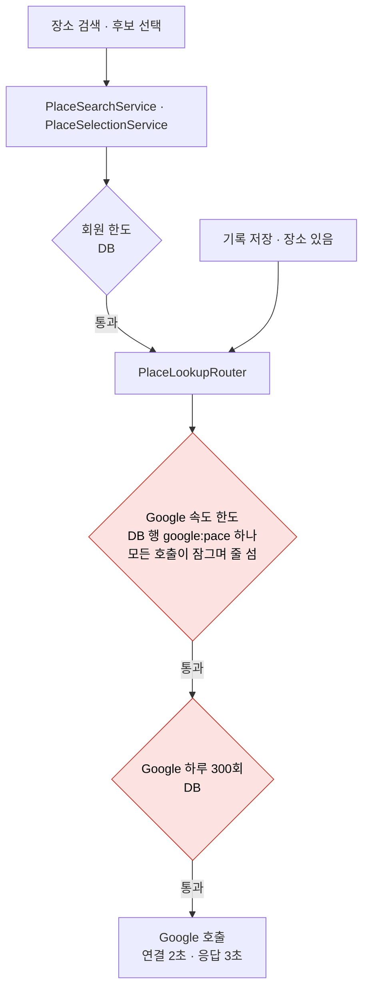

### 지금

회원 한도는 컨트롤러 앞 인터셉터가, Google 한도는 `GooglePlacesClient`가 확인한다. 서킷 브레이커(6장)가 한도 확인보다 앞에 있어, 회로가 열린 동안 거절한 요청은 Google도 월 한도도 쓰지 않는다. 분당 한도는 메모리에서 먼저 보므로 몰린 요청은 커넥션 없이 거절된다.

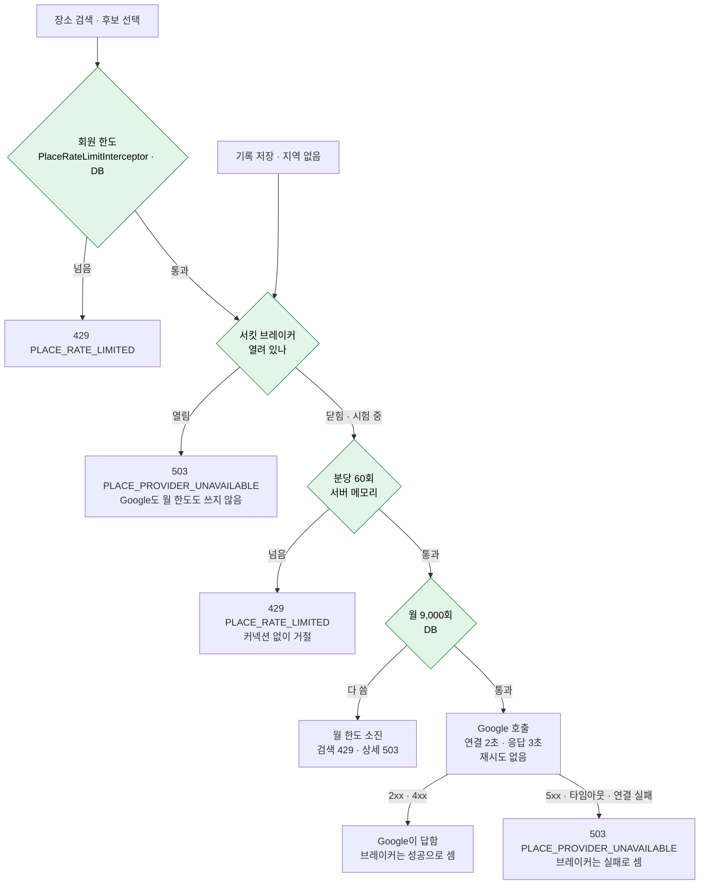

하루 300회는 바쁜 날에도 300회에서 막혔다. 지금은 월 무료 사용량(10,000건) 안에서 달마다 9,000회를 쓴다. 80%와 다 쓴 순간에 ERROR 로그로 알린다.

## 6. 외부 장애 대응 (#346: #365, #363)

### Google 서킷 브레이커 (#365)

개선 전에는 Google이 멈춰도 사용자마다 3초씩 기다렸고, 그 호출마다 월 한도를 썼다. 지금은 서버마다 최근 60초를 세어 실패가 많으면 회로를 연다(`google.places.circuit-breaker`).

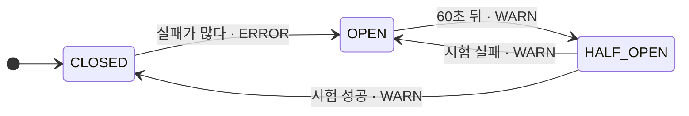

| 전이 | 조건 | 로그 |
| --- | --- | --- |
| CLOSED → OPEN | 최근 60초에 5번 이상 불렀고 절반 이상 실패 | ERROR(Discord 알림) |
| OPEN → HALF_OPEN | 60초가 지난 뒤 첫 호출. 그 전까지는 한도 확인 전에 바로 503 | WARN |
| HALF_OPEN → CLOSED | 시험 3번 중 실패 1번 이하 | WARN |
| HALF_OPEN → OPEN | 시험 3번 중 실패 2번 이상 | WARN |

운영 ERROR 로그 알람(Discord)이 장애 하나에 한 번만 울리도록, 닫혀 있다 열릴 때만 ERROR 로그(`event=GOOGLE_PLACES_CIRCUIT`)를 남긴다.

Google 결과마다 브레이커가 어떻게 세고 월 한도를 돌려주는지는 이렇다.

| 결과 | 브레이커 | 월 한도 | 이유 |
| --- | --- | --- | --- |
| 2xx | 성공 | 씀 | |
| 4xx | 성공 | 씀 | Google이 답했다. 상세 조회의 404와 키 오류가 아닌 400은 `PLACE_NOT_FOUND`다 |
| 5xx | 실패 | 돌려줌 | Google은 서버 오류를 과금하지 않는다 |
| 연결 거부 · 연결 타임아웃 · 없는 호스트 | 실패 | 돌려줌 | 요청이 Google에 닿지 않았다 |
| 응답 타임아웃 | 실패 | 씀 | 연결 뒤 끊겨 Google이 처리하고 과금했을 수 있다 |
| 우리 분당 · 월 한도 거절 | 세지 않음 | 분당 거절은 쓰지 않음 | Google을 부르지 않았다 |

Google이 2시간 동안 답하지 않으면(응답 타임아웃은 월 한도를 돌려주지 않는다), 브레이커가 없을 때는 요청이 몰리면 분당 60회씩 7,200회(월 한도의 80%)를 쓴다. 지금은 60초마다 시험 3번이라 최대 360회(4%)다.

### S3 타임아웃 (#363)

기록 저장은 사진마다 S3 `headObject`로 업로드됐는지 확인한다(`UploadedObjectVerifier`). 개선 2로 트랜잭션 밖이 되어 커넥션은 쥐지 않지만, 기다리는 동안 요청 스레드는 쥔다.

| | 개선 전(SDK 기본값) | 지금(`upload.storage.s3.client`) |
| --- | --- | --- |
| 시도당 응답 대기 | 30초 | 2초 |
| 최대 시도 | 4번 | 3번 |
| 호출 하나 전체 | 제한 없음(2분 가까이) | 6초 |

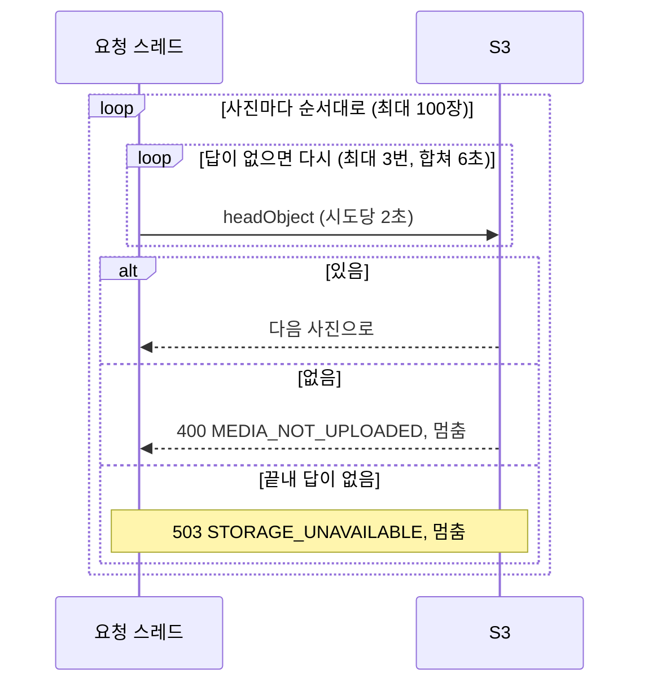

한 장이라도 실패하면 나머지는 확인하지 않으므로, S3가 멈추면 기록 저장은 사진 수와 관계없이 6초 안에 503으로 끝난다. 느리지만 답은 하는 S3에서는 사진마다 6초까지 쌓일 수 있다.

**S3 서킷 브레이커와 벌크헤드는 지금은 달지 않는다**(2026-10-14 결정).

- 요청 스레드 200개를 6초씩 쥐어 다 쓰려면 기록 저장이 초당 약 33건(200 ÷ 6) 와야 한다.
- SDK 재시도에도 토큰 통이 있다(500개, 재시도마다 5개, 성공하면 다시 참). 장애가 길어지면 재시도를 멈추고 2초 한 번만 시도해, 그 뒤로는 초당 약 100건이 와야 다 쓴다. 첫 시도는 막지 않는다.
- 사진은 앱이 presigned URL로 S3에 직접 올린다. S3가 멈추면 대부분 업로드에서 먼저 실패해 기록 저장까지 오지 않는다.
- 브레이커가 잘못 열리면 핵심 기능인 기록 저장이 막힌다.
- 기록 저장이 초당 수십 건이 되면 다시 본다. 그때 스레드 고갈만 막으려면 S3를 기다리는 스레드 수를 제한하는 벌크헤드가 맞다.

## 7. 요청별 커넥션 사용

코드에서 센 값이다. 개선 후 측정으로 아직 확인하지 않았다.

| 요청 | 빌리는 횟수(전 → 지금) | 외부를 기다리며 쥐는 커넥션(전 → 지금) |
| --- | --- | --- |
| 로그인 회원 API(예: `GET /travel-records`) | 2 → 1 | 0 → 0 |
| 기록 저장: 장소 + 지역(지금 앱) | 4 → 1 | 1 → 0 |
| 기록 저장: 장소만, 지역 없음 | 4 → 2(트랜잭션, Google 월 한도) | 1 → 0 |
| 기록 저장: 장소 없음 | 2 → 1 | 사진이 있으면 1 → 0 |
| 장소 검색 | 3 → 2(회원 한도, Google 월 한도) | 0 → 0 |
| 후보 선택 | 4 → 2(회원 한도, Google 월 한도) | 0 → 0 |

개선 전 장소 검색은 회원 한도, Google 속도 한도, Google 하루 한도로 3번이었다. 후보 선택은 여기에 전체 선택 한도가 하나 더 있었다.

## 8. 남은 한계

- **풀 크기는 10개 그대로다.** 개선 후 dev에서 10개로 다시 재고, DB CPU를 보면서 늘릴지 정한다.
- 서킷 브레이커는 서버마다 메모리에서 센다. 서버가 여러 대면 서버마다 따로 열린다.
- 앱은 Google 장소를 골라야 새 기록을 만들 수 있어, Google 장애가 기록 생성을 막는다. 서버는 지역만으로도 Google 없이 기록을 만든다. 장소 검색이 실패할 때 지역 직접 선택으로 넘어가는 것은 앱에서 다룬다.

## 9. 지키는 테스트

백엔드 PR마다 CI(`Backend CI`)에서 돈다. 각 개선의 핵심 테스트는 고치기 전 코드에서 먼저 실패하는 것을 확인했다.

| 지키는 것 | 테스트 |
| --- | --- |
| 로그인 회원 API가 커넥션을 한 번만 빌림 | [`LoginMemberConnectionUsageTest`](../src/test/java/com/mapmory/backend/auth/security/resolver/LoginMemberConnectionUsageTest.java) |
| 기록 저장·수정의 외부 호출이 트랜잭션 밖 | [`TravelRecordExternalCallTransactionTest`](../src/test/java/com/mapmory/backend/travelrecord/TravelRecordExternalCallTransactionTest.java) |
| 지역이 있는 기록 저장·수정은 Google을 부르지 않음 | [`TravelRecordGooglePlaceTest`](../src/test/java/com/mapmory/backend/travelrecord/TravelRecordGooglePlaceTest.java) |
| 분당 한도 거절은 풀이 바닥나도 커넥션 없이, 월 한도 환불 | [`GoogleRequestLimiterIntegrationTest`](../src/test/java/com/mapmory/backend/place/infrastructure/google/GoogleRequestLimiterIntegrationTest.java) |
| 서킷 브레이커 상태와 로그 수준, 환불 기준 | [`GooglePlacesClientTest`](../src/test/java/com/mapmory/backend/place/infrastructure/google/GooglePlacesClientTest.java) |
| S3가 답하지 않으면 6초 안에 3번 시도하고 503 | [`S3ClientTimeoutTest`](../src/test/java/com/mapmory/backend/upload/storage/S3ClientTimeoutTest.java) |
